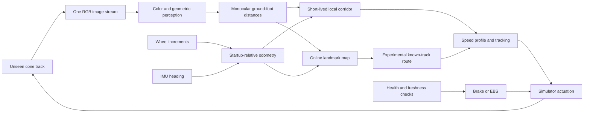

# Research and implementation dossier

**Monocular FSDS autonomy · updated 15 October 2026**

This dossier explains the implemented solution, why earlier versions failed, what
the experiments show, and what remains unproven. It is an implementation study,
not a claim of a winning model or a statistically validated driverless vehicle.

## Research question

Can one forward RGB camera, supported by wheel encoders and IMU, discover an
unseen cone track and drive it without prior track geometry, LiDAR or stereo?

The current answer is **feasible in the tested simulator, but reliability and
race-speed generalization remain open**. The software is a classical
geometry/control pipeline, not a trained end-to-end neural model.

## Reading order

| Chapter | Purpose |
|---|---|
| [System and runtime](system-and-runtime.md) | Windows, WSL, Docker, ROS, RPC, startup, clocks and observer boundaries |
| [Algorithms and mathematical models](algorithms.md) | Every driving layer, decisions, equations, assumptions and failure propagation |
| [Persistent mapping and lap-time planning](persistent-mapping.md) | Temporal triangulation, immutable cone IDs, post-lap correspondence and periodic speed optimization |
| [Evolution and experiments](evolution.md) | Previous approaches, root causes, changes, controlled versus bundled comparisons |
| [Measurement protocol](measurement-protocol.md) | Timing definitions, CPU/GPU/RAM conventions, reproducible tests and interpretation |
| [Measured results](results.md) | New run summaries and links to time-series/distribution figures |
| [Release gates](../roadmap.md) | Remaining work before reliable racing or hardware deployment |

The [interface specification](../../FSD_System_Interface_Specification.md) and
[architecture reference](../../ARCHITECTURE.md) remain the concise implementation
contracts. This dossier adds explanation and evidence rather than replacing them.

## Solution at a glance

No single layer is responsible for “accuracy.” Camera calibration, appearance
gates, temporal alignment, associations, corridor construction, control and
freshness all have to agree. Improving one layer can expose a downstream error.

## Evidence vocabulary

- **Observed:** present in code, logs, recorded telemetry or a direct system check.
- **Verified:** reproduced by an explicit test, with conditions and result recorded.
- **Inferred:** a plausible explanation supported by measurements, not isolated causality.
- **Proposed:** a future experiment or acceptance gate, not an implemented result.

The constant detection confidence of 0.8 is not 80% accuracy. Map count is not
recall. A clean lap is not proof of perfect localization. A 50 Hz average is not
a 20 ms worst-case response guarantee. No unmeasured metric is filled with a
plausible-looking value.

## Figures and continuous inspection

Mermaid diagrams describe static structure and decisions. Recorded plots show
actual time-dependent behavior. [The read-only replay viewer](../../fsd_ws/tools/research-replay.html)
opens locally and accepts an evaluation JSON; Play/scrub updates the vehicle
heading, estimated map, local path, controls and sampled layer timings.

The viewer does not connect to FSDS or issue controls. It does not invent
intermediate cone observations or show the final map as if it were known at
startup. The existing live dashboard remains available at localhost:8321 while
FSDS runs. Static GitHub figures do not update live; regenerate them from a new
recording with the reporting command in the measurement protocol.
