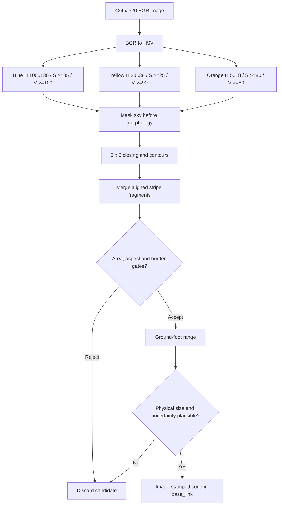
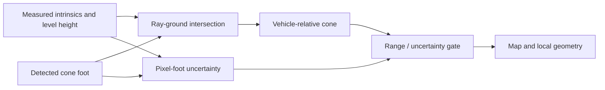
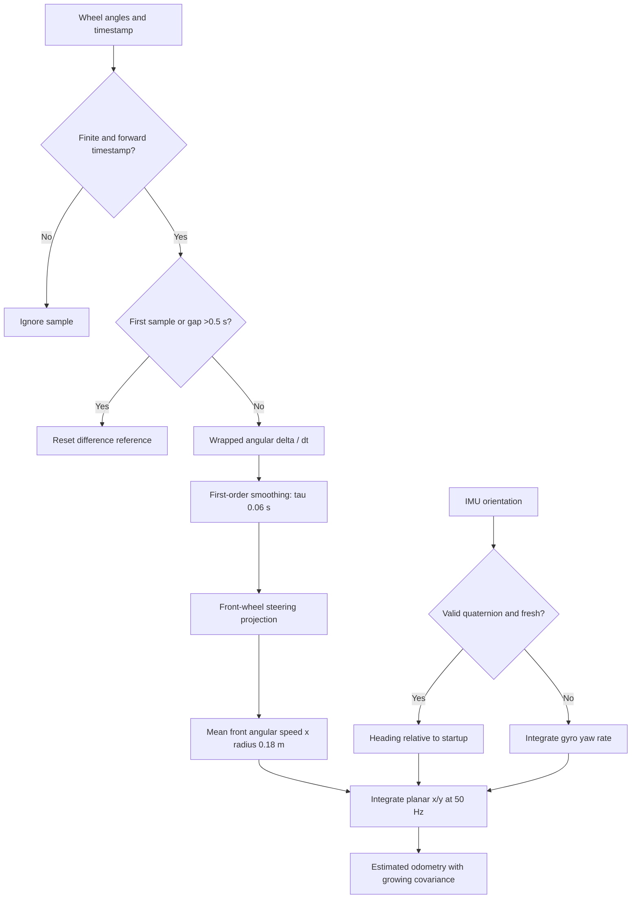
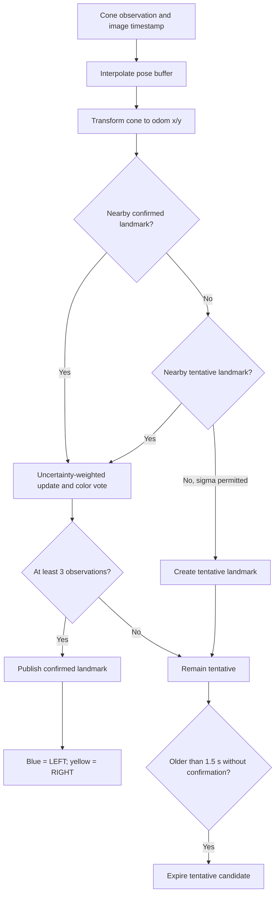
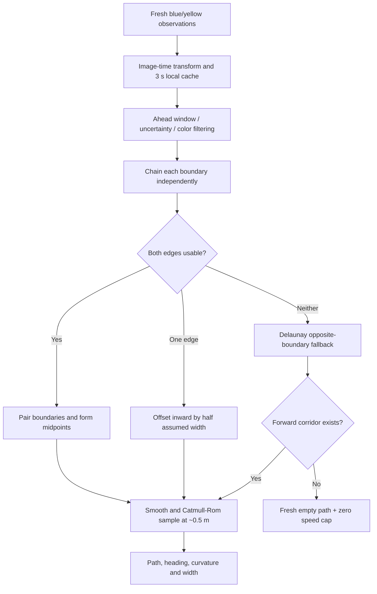
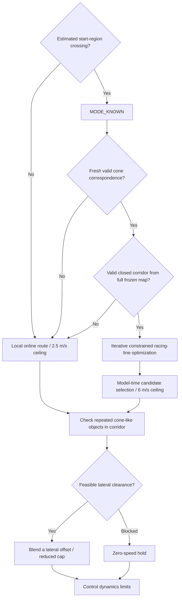
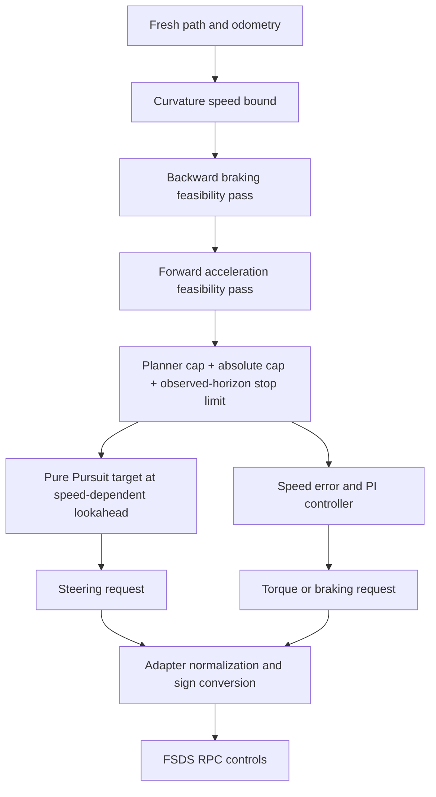
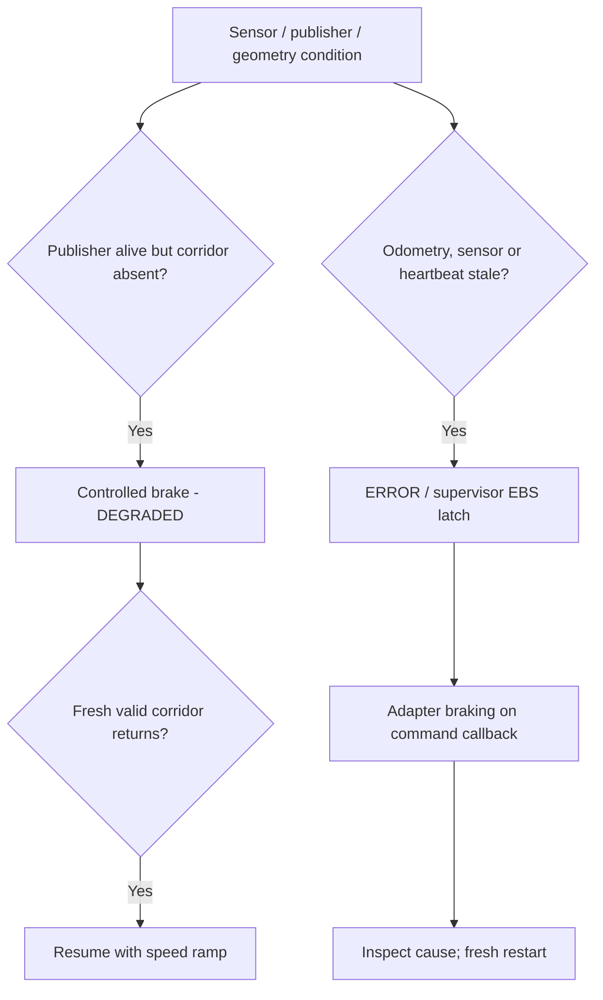

# Algorithms and mathematical models

[Research index](README.md) · [Evolution](evolution.md)

## 1. What model is actually used?

There are **no trained weights, YOLO, TensorRT inference, stereo depth or LiDAR**
in the tested path. “Model” here means:

| Layer | Implemented model |
|---|---|
| Appearance | HSV color ranges plus contour/shape constraints |
| Geometry | Pinhole projection and calibrated flat ground |
| Motion | Planar wheel displacement and IMU heading |
| Landmarks | Unique color-gated association, temporal bearing triangulation, immutable post-lap map |
| Track | Colored boundary chains, fallback triangulation and interpolated curves |
| Speed | Curvature/acceleration/braking constraints |
| Tracking | Pure Pursuit lateral control and PI longitudinal control |

This combination is explainable and inexpensive at low resolution, and matches
the structured cone-track task. It is not universally more accurate than a
learned detector; no such benchmark has been performed.

## 2. Perception: image to admissible cone



HSV separates hue, saturation and brightness; this is the standard kind of
color segmentation supported by OpenCV's
[inRange operation](https://docs.opencv.org/4.13.0/da/d97/tutorial_threshold_inRange.html).
The particular thresholds and gates are project-specific simulator tuning.

Old blue thresholds included bluish road, connecting a true cone to a large
background component. Tightening saturation/value separates it. Lower yellow
saturation admits pale cones. Masking sky before connected components is
important: rejecting a sky-connected bounding box afterwards can also reject
a real cone joined to it. Fragment merging preserves striped cones without
using an oversized closing kernel that joins neighboring cones.

These changes remove demonstrated failure mechanisms. They do not establish a
dataset-wide precision or recall. Shadows, blur, color shifts and objects with
similar color/shape can still defeat the detector. Orange-small is the default
orange extraction class; this is not a robust learned cone-size classifier.

## 3. Monocular distance and uncertainty

Let `f_y = 302.8 px`, camera ground height `h = 0.8 m`, principal row
`c_y = 160 px`, cone-foot row `v_b`, and box-center column `u`.

```text
Z = f_y h / (v_b - c_y)
Y_left = -(u - c_x) Z / f_x
X_base = camera_forward_offset + Z
sigma_Z = sqrt[(1.5 Z / (v_b - c_y))² + (0.03 Z)²]
```

The foot must lie below the horizon. Calibrated mount height differs from the
absolute RPC camera world elevation. We reject implausible inferred dimensions
and range >18 m; local planning requires sigma ≤1.5 m.



The derivative `|dZ/dv| = Z²/(f_y h)` explains quadratic range sensitivity:
a pixel error is much more expensive far away. The alternative known-height
formula `Z = f_y H_cone / bbox_height` is sensitive to a stripe fragment or
truncated box. Foot ranging avoids that specific dependence when the foot is
visible, but becomes biased if camera pitch or the ground plane is wrong.


This is an analytic sensitivity plot, **not measured detection accuracy**.
Unmodelled downward pitch changes the observed ray angle; the plotted bias
uses `Z_hat = h / tan(atan(h/Z) + pitch)`. Real mount flex, braking pitch and
slopes therefore need explicit treatment before increasing speed.

## 4. Wheel increments and IMU heading



```text
delta_theta = remainder(theta_now - theta_previous, 2 pi)
omega = delta_theta / delta_t
alpha = delta_t / (0.06 + delta_t)
omega_filtered += alpha (omega - omega_filtered)
v = 0.18 (omega_front_left + omega_front_right) / 2
x += v cos(yaw) dt;  y += v sin(yaw) dt
```

Raw physics-time RPM integrated against a slow wall clock previously stretched
distance. Front wheels reduce driven-wheel-spin contamination. Absolute
simulated IMU orientation avoids repeatedly integrating the same yaw signal.

This remains dead reckoning, not an EKF/visual-inertial SLAM solution. Radius
bias, lateral slip and timing errors accumulate. Wrapped increments also assume
less than pi radians of wheel movement between usable samples; sufficiently
large gaps/high speeds can alias. That risk is a proposed high-speed test, not
a diagnosed explanation for every recorded drift.

## 5. Landmark mapping



For a scalar coordinate, the update has the form
`K=P/(P+R); mu'=mu+K(z-mu); P'=(1-K)P`, with observation variance derived from
range uncertainty. Association searches the spatial grid with a sigma-scaled
gate clamped between 0.5 and 1.5 m. It is proximity-based, not globally optimal
data association. Confirmed entries are not removed mid-run.

The latest experimental profile permits translation-only visual feedback during
learning; its FSDS rerun is pending. After the first inferred lap the map freezes
and unique, color-compatible correspondences may correct translation; the FSDS
IMU remains the heading reference. Map count
exceeding the 196 reference cones is evidence of duplicates/drift, not superior
recall. [Triangulation and lifecycle details](persistent-mapping.md).

## 6. Online first-lap corridor



Recovery uses cone **color semantics**, not a sign test on observed lateral
position. A blue cone remains the left edge even when the car has crossed it;
its inward offset must not reverse. The default single-edge width is 3.5 m,
an assumption that can be wrong on a different track.

A short cache bridges brief occlusion without trusting a whole lap of drifting
landmarks. It does not make invisible geometry known. On first-lap corridor loss,
the planner must stop, not refresh the timestamp of an old path.

## 7. Known-track route and object handling



A crossing flag is not corrected SLAM loop closure. The geometric racing line
is not proven time-optimal. Full-map drift can make known-track operation worse
than short local planning. There is no general-object or dynamic-object model.
These capabilities need dedicated experiments, not extrapolation from clean
low-speed first laps.

## 8. Speed profile and actuation



```text
v_curvature <= sqrt(a_lateral / max(abs(curvature), epsilon))
v_before <= sqrt(v_after² + 2 a_brake delta_s)
lookahead = clamp(0.8 v, 2, 8) metres
steering = atan2(2 wheelbase sin(alpha), actual_lookahead)
stopping distance = reaction_time v + v²/(2 a_brake) + reserve
```

The implementation uses Pure Pursuit geometry and PI speed feedback. The classic
algorithm and lookahead trade-offs are described by
[Coulter's primary report](https://publications.ri.cmu.edu/implementation-of-the-pure-pursuit-path-tracking-algorithm).
Project-specific gains/limits are in fsds_params.yaml, not established physical
tire/actuator limits. Commands are published at 50 Hz, but actual response also
depends on queueing, bridge RPC, physics and wheel dynamics.

## 9. Safety and failure propagation



The existing adapter still lacks an independent command/keepalive timeout, and
its brake publication depends on control callbacks. The new diagnostics do not
remove this safety gap. Fixed thresholds are engineering parameters, not certified
safety guarantees. A research-quality conclusion must preserve failed runs and
unvalidated behavior alongside successful plots.
