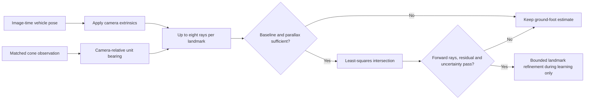
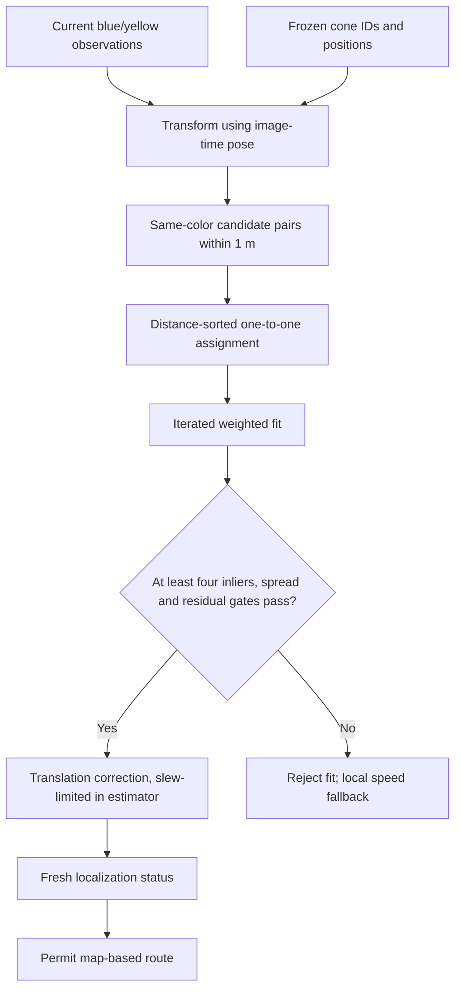
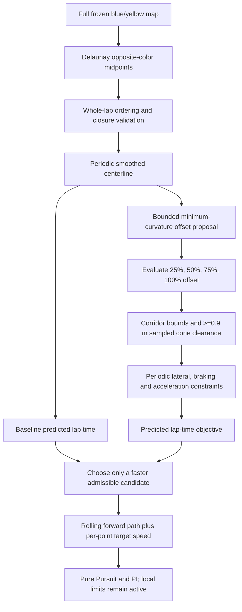

# Persistent monocular mapping and lap-time planning

Implementation update: **15 October 2026**. Runtime evidence is reported separately
in [results](results.md); synthetic tests are not simulator lap validation.

## Mission lifecycle

```mermaid
stateDiagram-v2
    [*] --> Learn
    Learn: Online local corridor, 2.5 m/s ceiling
    Learn --> Freeze: Estimated start crossing after minimum distance
    Freeze: Deduplicate once; retain confirmed cone IDs and coordinates
    Freeze --> Localize
    Localize --> Race: Fresh unique correspondences AND valid closed route
    Race: Reuse full map and periodic speed profile; ceiling 6 m/s
    Race --> Localize: Correspondences lost or fit rejected
    Localize: Local corridor fallback at exploration ceiling
    Learn --> Emergency: Sensor or node freshness failure
    Race --> Emergency: Sensor or node freshness failure
    Localize --> Emergency: Sensor or node freshness failure
    Emergency: Latched brake; restart required
```



Learning is within a running mission: the map stays in memory, not a trained
neural network. It is not yet a versioned, reloadable surveyed map. An inferred
start-line crossing is not a globally optimized SLAM loop closure.

## Two different meanings of triangulation

**Temporal bearing triangulation** estimates one physical cone from the same
camera at multiple vehicle poses. It does not add a second camera. The initial
cone distance still comes from the calibrated ground-foot model.

For camera origins `c_i`, unit ground-plane bearings `d_i`, and perpendicular
normals `n_i = [-d_iy, d_ix]`, solve:

```text
minimize_p sum_i [n_i^T (p - c_i)]^2
A = sum_i n_i n_i^T; b = sum_i n_i n_i^T c_i
p = inverse(A) b
```



Guards: at least three views; camera movement between stored rays >=0.2 m;
overall baseline >=0.4 m; parallax >=0.025 rad; conditioned normal matrix;
forward range 0.5–25 m; each angular residual <=0.02 rad; sigma <=0.75 m;
refinement displacement <=0.6 m and gain <=0.25. Sigma has a 0.1 m floor.
Forward travel toward a distant cone can remain degenerate; such a solve is
rejected. Odometry error affects all rays, so they are not independent truth.
The code does not reduce covariance by counting triangulation as another
independent image observation.

**Delaunay triangulation** instead connects an existing set of cone locations.
Opposite-color edges yield corridor midpoints. It constructs track topology;
it does not estimate metric camera depth. Both mechanisms exist for different
purposes.

## Color-constrained correspondence and immutable racing map

During learning, a detection may update at most one slot, and a slot may be
used once per image. Blue observations match only blue landmarks, yellow only
yellow. Confirmed landmarks take precedence over tentative candidates.

At the first inferred lap crossing, tentative entries are discarded and
confirmed same-color duplicates within 0.7 m are removed once, retaining the
older ID. Thereafter the mapper does **not** spawn, promote, move or recount
landmarks. Unmatched detections are localization failures, not new map entries.



This is a gated greedy assignment, not a globally optimal assignment algorithm.
Only observations with range sigma <=1.2 m enter registration. Final RMS must
be <=0.35 m, spread >=2 m² and translation <=1 m. The FSDS profile **locks
heading to IMU orientation**; visual yaw feedback on a self-built map caused
large drift in an earlier trial. The last recorded run disabled visual
registration during learning and enabled it after freeze. The current
experimental profile additionally enables translation-only registration during
learning; that configuration has not yet been rerun in FSDS. No
`/testing_only` input is used. See the [evidence boundary](results.md).

The estimator replaces pending corrections rather than accumulating repeated
measurements; translation is slew-limited to 1 m/s. Generic unlocked-heading
support preserves an IMU offset across callbacks, but it is not the FSDS default.
This local matcher cannot recover arbitrary multi-metre displacement: loss of
correspondence must not authorize racing speed.

## Whole-lap route and speed selection

The previous global builder accidentally received only the local 25 m window,
and its chain search inherited a 40-point local limit. Both are corrected: the
global builder receives the full frozen boundary map and may traverse the full
midpoint set. It still rejects incomplete/shortcut loops (closing gap >6 m or
coverage <75% of extracted midpoints).



```text
v_i <= min(v_cap, sqrt(a_lateral / max(abs(curvature_i), epsilon)))
v_i^2 <= v_(i+1)^2 + 2 a_brake ds_i
v_(i+1)^2 <= v_i^2 + 2 a_accel ds_i
T_model = sum_i 2 ds_i / (v_i + v_(i+1))
```

Passes wrap across the start/finish seam. The model currently uses lateral
6 m/s², acceleration 3 m/s², braking 6 m/s², matching controller configuration.
If those values change, change both implementations together. `PathPoint`
includes `target_speed_mps`; zero keeps legacy local-profile behavior.

This is **model-scored candidate selection**, not a proof of a globally
minimum-time racing line. It omits tyre load transfer, friction ellipse,
actuator delay and tracking uncertainty. Sampled cone distance is not a swept
vehicle-body clearance guarantee. Predicted times must not be presented as
measured FSDS lap times. The first unseen lap remains online/local planning.

Racing requires status younger than 0.5 s, a frozen map, valid localization,
at least four correspondences, correspondence ratio >=0.4 and RMS <=0.35 m.
Otherwise local fallback stays at 2.5 m/s (or lower for obstacles/visibility).

## Regression coverage

- Dependency-free geometry tests: exact/degenerate ray intersections, unique
  color matches, rigid registration, locked heading, periodic speed feasibility.
- Built mapper: a crossing freezes IDs/coordinates; subsequent unmatched cones
  cannot change the map.
- Built planner: a 144-cone synthetic circle supplies a full periodic route
  even when local observations cover only 9 m; correspondence loss removes the
  race-speed authorization.
- Existing built-node tests: colored-side recovery, startup ramp, stale planner
  braking, wheel spin exclusion, encoder wrap, sky/pale-yellow cases.

Run `test_map_lifecycle.py` only in its isolated ROS domain. It is a regression
fixture, not evidence that FSDS completed a faster second lap.
