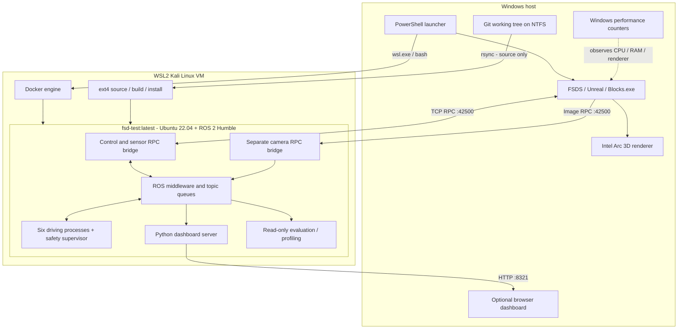
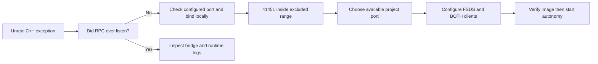
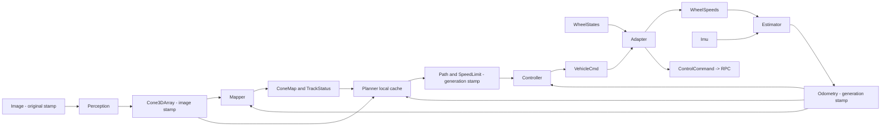
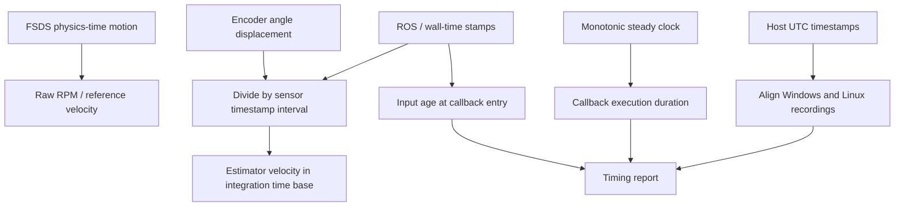
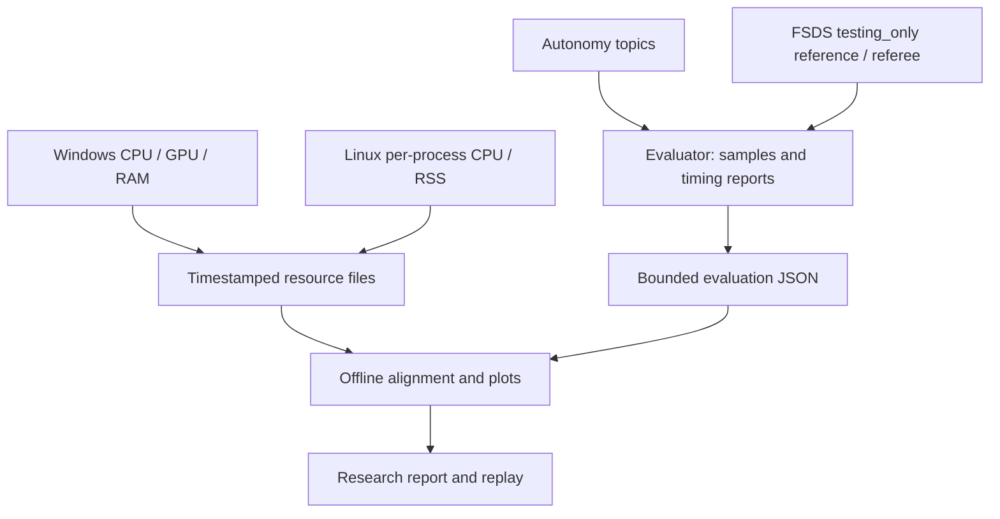

# System and runtime

[Research index](README.md) · [Algorithms](algorithms.md)

## 1. Execution environments are different layers



Windows runs the graphics/physics application. WSL runs a Linux kernel and ext4
workspace. Docker supplies the Ubuntu/ROS userspace; it is not a second simulator.
ROS links processes through typed messages; the FSDS bridge translates RPC into
those topics. The laptop's GPU renderer load is not Jetson autonomy GPU load.

Source is synchronized into ext4 for build/runtime I/O. Build/install stay there;
small logs return to Windows. The bridge repository is an external dependency,
mounted read-only during normal demos. Its port-override patch is tracked here.

## 2. Startup sequence

```mermaid
sequenceDiagram
    participant P as PowerShell
    participant W as Windows networking
    participant F as FSDS
    participant B as WSL / Docker / bridge
    participant R as ROS driving stack
    participant E as Evaluator
    P->>P: Read single-camera settings
    P->>W: Test configured RPC port binding
    alt Port excluded or occupied
        W-->>P: Fail preflight with diagnostic
    else Port available
        P->>F: Fresh TrainingMap spawn
        F->>W: Listen on configured RPC port
        P->>B: Sync source and launch container
        B->>B: Build if requested; source overlays
        B->>F: Connect both RPC clients
        F-->>B: First complete RGB frame
        B->>E: Start bounded observer
        B->>R: Start autonomy and optional timings
        R->>R: Sensors -> odometry -> valid corridor
        R->>F: First propulsion request
        F-->>E: First reference motion
    end
```

“Initialized” is not one event. We separately record simulator spawn, RPC
listening, source sync, bridge launch, verified camera frame, stack launch,
dashboard readiness, first odometry/path/command and first observed motion.
These are cumulative milestones; summing their timestamps double-counts time.
No-build initialization excludes compilation and is not clean-machine installation.

### September 23 startup failure and fix

Observed twice: FSDS raised C++ exception `0xe06d7363` before opening RPC.
Windows excluded 41437–41536; a local bind to 41451 returned AccessDenied.
A local bind to 42500 succeeded. After setting `ApiServerPort: 42500` and
updating both bridge clients, RPC and camera delivery succeeded and driving resumed.

The generic exception was not itself proof of a port failure; the bind test and
successful targeted retry supplied the evidence. Windows reservations were not
removed. A separate Windows-to-Bash CRLF issue was caught during source sync;
the launcher now normalizes the script and invokes Bash with errexit.



This is a diagnosis of this machine's observed failure, not a universal meaning
of `0xe06d7363`. Microsoft's
[Winsock bind-error guidance](https://learn.microsoft.com/en-us/troubleshoot/windows-server/networking/error-10013-wsaeacces-is-returned)
also describes excluded-port/access errors, under its own documented conditions.

## 3. ROS data ownership



The map and path are estimates. Their generation timestamps do not imply that
every landmark is a fresh observation. Pose-buffer interpolation supports
camera-time placement, but endpoint clamping is not strict synchronization.

Image reception is best effort with a depth-one queue; most internal contracts
are reliable with small queues. Reliable delivery does not eliminate scheduling
delay, stale messages or blocked callbacks. See the primary
[ROS QoS documentation](https://docs.ros.org/en/humble/Concepts/Intermediate/About-Quality-of-Service-Settings.html).

## 4. Clock domains and response-time semantics



Three distinct measurements:

1. **Execution duration:** entry to scope exit, measured with a monotonic clock.
   Includes the instrumented callback's computation and ordinary publications;
   excludes the diagnostic publication itself.
2. **Input age:** ROS time at entry minus one selected input stamp. Includes
   transport/queue age and may include older sensing. Planner reports its latest
   cone-array stamp, not the age of every cached landmark actually used.
3. **Observed response:** first propulsion request to first reference speed above
   0.2 m/s, as seen by one observer. This is an onset measurement, not steering
   step response, actuator dynamics or a fully traced camera-to-tire latency.

Adding independent p95s is not an end-to-end p95. The current messages do not
carry a causal frame ID through map, path, controller and physics application.
A future end-to-end experiment needs such lineage and actuator-side timestamps.

## 5. Independent observers and feedback separation



There is no edge from the evaluator/reference geometry back to driving. The
observer still costs CPU and subscribes to data; it can perturb the measured
system. The experiments report this workload rather than treating measurement
as free. Instrumentation defaults off; `-Research` enables it explicitly.
